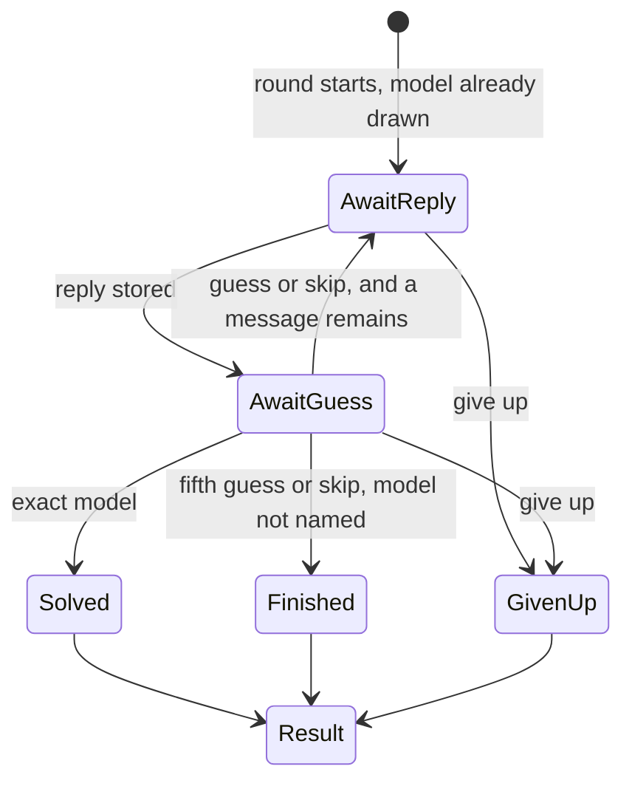

# Rules

Scoring numbers live in `lib/config.ts` and are copied onto the game when it starts. This page is the meaning of those numbers.

## A turn



1. The player sends a message. The header reads `Message 1 of 5`.
2. The server calls the hidden model. The guess opens only after the reply is stored. A failed call does not spend the message.
3. The player submits one guess, or skips. A second guess on that message is rejected. A skip spends the slot and writes no guess row.
4. The server compares characteristics, pays new matches once, and returns the chip board. The model id is not in that response.
5. The player may reveal a missed characteristic. That costs points and does not call the model.
6. Naming the exact model ends the round as `solved`. After the fifth guess or skip, if the model was never named, the round ends as `finished` and the partial points stay. Give up ends as `given_up` and keeps the points already banked. Give up asks for confirmation.

The next message stays disabled while a guess is open. Refresh restores the same state from the server.

Reveals are allowed only while the round is `active`, and only after the first reply. A reveal before any conversation would identify the model without playing.

Guesses and reveals do not call OpenRouter.

## Characteristics

These seven are the whole model, for the purpose of the game. Two models match a row when the stored values are equal.

| Key | Stored as | Match | Chip when it matches | Chip when it misses |
|---|---|---|---|---|
| `company` | `models.company_id` | Same company | Company name | Wrong company |
| `family` | `models.family_id` | Same family | Family name | Wrong family |
| `region` | `companies.region` | Same `us` / `eu` / `cn` | American, European, or Chinese | Wrong region |
| `size` | `models.size` | Same `small` / `medium` / `large` | Small, medium, or large | Wrong size |
| `weights` | `models.open_weights` | Both open or both closed | Open-weight or closed | Wrong |
| `year` | calendar year of `released_on` | Same year | The year | Newer than your guess, or older |
| `reasoning` | `models.reasoning` | Both thinking, or both not | Thinking, or not a thinking model | Wrong |

Year direction uses the full date, and only when the calendar years differ. Same year is a match, including March against November. The direction text does not include the year. It appears after submit. Moving through the search list does not compare anything.

Display labels:

| Stored | Shown |
|---|---|
| `us` / `eu` / `cn` | American / European / Chinese |
| `small` / `medium` / `large` | Small / Medium / Large |
| `open_weights` true / false | Open-weight / Closed |
| `reasoning` true / false | Thinking model / Not a thinking model |

### Given chips

A characteristic every model in the pool shares is given. It is filled in when the round starts, it pays nothing, and it has no reveal button.

Compute it from the pool, not from a hardcoded list per category:

```
pool = enabled models matching the category and pool_key
for each characteristic:
  if the pool has exactly one distinct value:
    that characteristic is given, and the value is that one
```

Origin skips this. It has no chip board.

Consequences, so we do not special-case them in the UI:

- Company mode gives company. Region is given too, because a company has one region.
- A family that belongs to one company gives family, company, and region. Size is given when that family has one size.
- Region mode gives region. Size mode gives size.
- All-models mode gives nothing, unless the whole roster happens to share a value. Do not enable a roster that is all American and then act surprised that region is given.

### Known values

A value becomes known when it is given, revealed, or matched by a guess. The search list and the guess check use known values only.

Year direction is not a known value. "Older than your guess" does not filter the catalog. Filtering on it would binary-search the year for free. The year filters the list only after a match or a reveal.

The server refuses a guess that contradicts a known value (`409`, key named in the body). The client also hides those rows. Hiding is convenience. The refusal is the rule.

Match points pay once per characteristic per round, the first time a guess hits them. Later guesses still record the booleans. Revealing never pays match points, and guessing a revealed characteristic later still pays nothing.

If one model is left in the list, the player still has to submit it. The round does not solve itself.

## Reveals

A missed chip is a button. Clicking it shows the true value, subtracts the cost, appends the key to `games.revealed`, and narrows the list. Each key can be revealed once. A chip that is still unknown is not a button. Origin has no reveals.

The result page shows every characteristic. That is the end of the round, not a reveal, and it costs nothing.

## Play without hints

The lobby checkbox **Play without hints** is stored as `games.blind` and cannot change mid-round.

Blind removes the reveal buttons. The server rejects a reveal. Guess feedback stays: correct, wrong, and year direction. The raw score is multiplied by **1.25** because the missing values could not be bought. Origin stores `blind` false and does not multiply.

## Scoring

A round that never names the model still has a score. Solving pays a jackpot on top of the characteristics. Origin pays the jackpot only, for a correct region, and the characteristics add nothing. The breakdown shows the raw lines, including a negative raw, and the token line on token-scored categories.

```
raw = category_multiplier * jackpot     # jackpot is 0 unless this guess solved the round
    + sum(match points the player guessed, ignoring given characteristics)
    - sum(reveal costs)
raw = raw * 1.25                         # only when blind
```

On a token-scored category the points above are not the stored score. The round still pays the same characteristics, the same jackpot, and the same blind multiplier. At the end those points are scaled by the tokens the successful calls actually used.

```
points = max(0, raw)
tokens = sum(input_tokens + output_tokens)   # successful calls only

score = round(points)                                       # tokenScored false
score = 0                                                   # tokenScored and tokens is 0
score = max(0, round(points * tokenScale / tokens))         # tokenScale is 1000
```

A chat of 1,000 tokens leaves the points unchanged. Shorter than that raises them. Longer shrinks them. Rounding is to the nearest integer. A half rounds away from zero. `raw` can land on a half because of the 1.25 multiplier, so the non-token score is rounded too.

`tokens` sums `usage` rows for this round whose `error_code` is null. A failed call is left out, the same way it does not spend a message. `reasoning_tokens` and `cache_read_tokens` are not added. Some providers already count reasoning inside `output_tokens`, and adding the column again would count it twice.

The flag is `categories.token_scored`, copied into `games.rules.tokenScored` when the round starts. Daily is seeded on. The other built-ins are seeded off. A pool defaults off, and admin can turn it on. Custom cannot, because Custom has no score. On a mixed pool the flag taxes whoever drew the model that writes long replies. Daily is safe to turn on because every player that day has the same model.

The jackpot depends on the message number of the solving guess.

```
jackpot = 800 - 100 * (message_number - 1)
```

Message 1 pays 800. Message 5 pays 400. Then the category multiplier.

| Characteristic | Guessed | Given by the pool | Reveal cost |
|---|---|---|---|
| Company | 200 | 0 | 250 |
| Family | 150 | 0 | 180 |
| Release year | 100 | 0 | 120 |
| Size | 80 | 0 | 100 |
| Region | 60 | 0 | 80 |
| Weights | 50 | 0 | 70 |
| Reasoning | 40 | 0 | 50 |

Reveal costs more than the match, so buying the answer is a worse deal than guessing it. The player buys a chip to shrink the list.

| Category | Jackpot multiplier |
|---|---|
| All models | 1.00 |
| Daily | 1.00 |
| Latest | 0.90 |
| Family | 0.85 |
| Region | 0.80 |
| Size | 0.70 |
| Company | 0.60 |
| Origin | 0.30 |

The multiplier applies to the jackpot only. A company point is worth 200 in every mode except origin, and 0 when the pool already gave the company away. Origin has no characteristic points.

While a scored round is active, the header shows the banked score (matches so far, minus reveals, times 1.25 if blind) and the jackpot if they name the model on the open message. On a token-scored round both numbers are the scaled ones, and the header also shows the token count. Nothing is written to `games.score` until the round ends. The banked number is recomputed from `games.rules`, the guess rows, `revealed`, and the successful `usage` rows, so it cannot drift from a second counter.

Custom rounds skip this section. `score` and `score_breakdown` stay null. Reveals still open the true value, and they cost nothing. Blind still hides the reveal buttons. There is no 1.25 multiplier, because there is no score to multiply.

### Worked example

All models, not blind. The truth is Claude Sonnet 5.5: Anthropic, Sonnet, US, medium, closed, 2026, thinking.

Message 1, the player names a different US closed thinking model from another year.

- Region +60, weights +50, reasoning +40
- Year chip says newer or older, and pays nothing
- Company, family, and size stay wrong

They reveal family (−180). The list becomes that family. Message 2, they name Claude Sonnet 5.5.

- Jackpot `800 - 100 = 700`
- Family +150, company +200, size +80, year +100
- Region, weights, and reasoning already paid

`700 + 60 + 50 + 40 - 180 + 150 + 200 + 80 + 100 = 1200`

The same solve on message 5 pays a 400 jackpot instead of 700. A round that finds company and family and never the model scores `200 + 150`, plus whatever else matched, minus reveals.

Daily is token-scored. The same 1,200 points, with 1,500 tokens on the successful calls, stores `round(1200 * 1000 / 1500) = 800`. Another player with the same points and 3,000 tokens stores 400.

## Categories

The call is the same in every category: 5 messages, 500 characters, 500 output tokens, one system prompt, that model's low reasoning settings. A category changes the pool, and therefore which chips are given, plus the jackpot multiplier and whether the score is scaled by tokens. Which cards exist is a table, `categories`, edited in admin. The built-ins below are seeded. A pool you create there is one more row: a fixed set of models, a multiplier, a scored flag, and a token-scored flag.

| Category | Pool | Notes |
|---|---|---|
| `all` | Every enabled model | Main mode. Built-in |
| `company` | One company, at least 2 enabled models | Company and region come out given. Built-in |
| `family` | One enabled family, at least 2 enabled models | Often the hardest. Built-in |
| `region` | `us`, `eu`, or `cn`, at least 2 enabled models | Region is given. Built-in |
| `size` | `small`, `medium`, or `large`, at least 2 | Size is given. Built-in |
| `latest` | `is_latest` models, or one company's latest when it has at least 2 | Built-in |
| `daily` | One model, same for every player that UTC day | Once per account. Token-scored. Built-in |
| `origin` | Every enabled model | One region guess. No chips. Built-in |
| `custom` | The models the player checked, at least 2 | Not scored. Built-in |
| `pool` | Members of a category you created, that are enabled | At least 2 or the card stays off |

### Origin

Three buttons: American, European, Chinese. No chip board, no reveals, no model search. The other six characteristics are not shown and do not pay.

The player still has five messages. They have one guess for the whole round. After a reply they may skip and keep talking, and the guess is still available. The fifth reply has no skip. They pick a region. A guess ends the round, right or wrong. There is no second try.

A correct region solves the round. The jackpot uses that message's number, then the 0.30 multiplier. Message 1 pays `800 * 0.30`. Message 5 pays `400 * 0.30`. A wrong region scores 0. Blind is ignored. There is nothing to hide, so the 1.25 multiplier does not apply.

The result page names the model. The round itself never does.

### Custom

The player searches the enabled roster and checks the models in the round. Two is the minimum. There is no maximum other than the roster itself. The draw is uniform among the ones they checked, and that list is what they guess from.

The set is saved on the round as `pool_model_ids`. Given chips are computed from that set only. Two Opus models give company, family, region, and usually size. A mixed set gives nothing.

The round still has five messages, one guess each, reveals, and blind mode. It still counts toward the 10 games an hour, because the model call costs the same. Guesses are still stored, so the admin confusion table can include them.

It does not write a score, and it does not appear on a leaderboard.

Regions on companies:

- **us:** OpenAI, Anthropic, Google, Meta, xAI, Amazon
- **eu:** Mistral, plus any other lab we actually have a key for
- **cn:** DeepSeek, Qwen, Kimi, GLM, MiniMax, and the other Chinese labs on OpenRouter

Size, also manual:

- **small:** the cheap fast tier
- **medium:** the workhorse
- **large:** the flagship, and only the large models we are willing to pay for

`is_latest` is a manual flag, usually one to three models per company.

The first daily start of a UTC day draws one model from the enabled roster and freezes that id and that roster on the day. Later starts copy both, so a model turned off at noon is still guessable today and a model turned on at noon is not added. Do not publish the id ahead of time. Starting spends the day, including a give-up before the first message. The result page may say how many players solved it once that day has finished rounds.

A pool with fewer than 2 enabled models is not listed, except daily and origin, which draw from the whole enabled roster. An empty roster is not playable in any category. Europe will be thin. A row with fewer than 4 models still appears, and it shows the count. A category with `enabled = false` is not listed at all.

Two models side by side, and a blind ranking vote, are different games. They are not this one.
