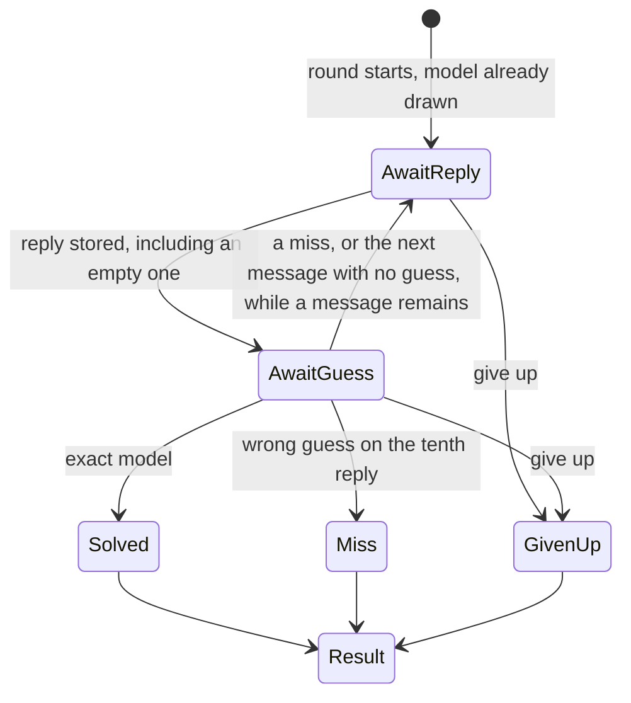

# Rules

Scoring numbers live in `lib/config.ts` and are copied onto the game when it starts. This page is the meaning of those numbers. It is not a public page. The player sees the short explanation on the result page, specified in [Pages](pages.md).

**All models** is the first build. The other categories below are specified and come later.

## A turn



1. The player sends a message. The header reads `Message 1 of 10`.
2. The server calls the hidden model. The reply streams word by word. The guess opens only after the reply is stored. A failed call does not spend the message. A successful call spends the message even when the stored reply is empty or whitespace.
3. The player may name one model from the list the server still allows, send the next message with no guess, or give up. A second guess on that same message is rejected.
4. Naming the exact model ends the round as `solved`. That correct name does not take the wrong-guess penalty. Earlier wrong names still do.
5. A wrong guess on the tenth reply ends the round as `miss`. The region and company matches still count. The round does not end by itself when the tenth reply arrives. The player can still guess or give up.
6. Give up ends the round as `given_up`, shows which model it was, and keeps that round off the leaderboard. Give up asks for confirmation.

Sending the next message while a guess is open drops that guess. The composer stays open until the tenth reply is stored, or the round ends. Refresh restores the same state from the server.

Guesses and hint purchases do not call OpenRouter.

A give-up before the first stored reply has no score. A give-up after at least one reply still runs the formula below, shows the total, and stays off the leaderboard.

## Traits

Two models match a trait when the frozen values are equal. Trait edits in the catalog apply only to new games. The round freezes the traits it will use when it starts, for every model in the pool.

### Point traits

These are the only traits that pay.

| Key | Stored as | Match | Points | Shown as |
|---|---|---|---|---|
| `region` | the company's region on the frozen row | Same `us` / `cn` / `eu` | 100 | USA, China, Europe |
| `company` | `company_id` on the frozen row | Same company | 300 | The company name |

If the player names the model, on any reply, the base is **2000**. Region and company do not stack on top of it, and the reply number does not change it.

If they never name the model, the base is 100 when any guess matched the region, plus 300 when any guess matched the company. Both is 400. A trait the pool gave them, or that they revealed with a hint, pays nothing, so it is left out of the base.

Each point trait pays at most once per round.

### Hints

Company, region, year, and size award no points. Each can be bought once, after at least one reply is stored, and only when the category allows hints. The price is subtracted from the base, before the token factor.

| Hint | What the player sees | Price |
|---|---|---|
| Company | The company name | 600 |
| Region | USA, China, or Europe | 400 |
| Year | The calendar year of `released_on` | 100 |
| Size | Small, medium, or large | 100 |

There is no free newer/older clue. A revealed trait is known afterwards, the same way year and size are, so the guess list drops models that do not match it.

A hint is not offered for a trait the round already showed: a given value, a value already revealed, or a company or region a guess already matched. There is nothing to buy.

Hints are hidden in no-hint mode. They are also off on the narrow pools named in [Categories](#categories). Buying any hint means the round is not a no-hint round, so it does not get the 2× multiplier.

### Out of play

Weights and reasoning are not chips, hints, filters, or score terms. The columns can stay on `models` as admin facts. A round does not copy them into its frozen traits, and play does not read them.

## Given values

A trait every model in the pool shares is given. It is filled in when the round starts, it pays nothing, and it is not a hint.

Compute it from the frozen pool, not from a hardcoded list per category:

```
pool = the models frozen on this round
for company, region, year, and size:
  if the pool has exactly one distinct value:
    that trait is given, and the value is that one
```

Consequences:

- All models gives nothing, unless the whole roster shares a value. Do not enable a roster that is all USA and then act surprised that region is given.
- A company pool gives company. Region is given too, because a company has one region. Both pay nothing.
- A region pool gives region, and region pays nothing.
- Origin has no trait board. The player is guessing the region itself.

## Known values and the guess list

A value becomes known when it is given, bought as a hint, or matched by a guess. Region and company matches count. Every hint trait also counts once it is bought.

When hints are on, a guess that misses the company removes every model from that company. A guess that hits the company and misses the model leaves the other models from that company.

In no-hint mode, matches are not shown and do not narrow the list. A company miss does not remove that company either. Narrowing would tell the player what they hit. The score still counts those matches. Given values can still be shown, because every model in the pool shares them.

The server filters the guess list as known values change. The client shows logo, company, and name only. It does not receive region, year, size, or any other trait, and it does not filter the list itself.

The server refuses a guess that is not in the filtered list (`409`). Hiding rows is not left to the browser.

If one model is left in the list, the player still has to submit it. The round does not solve itself.

## No-hint mode

The lobby checkbox **Play without hints** is stored as `games.no_hint` and cannot change mid-round.

Playing with no hints:

- Do not offer any hint purchase. The roster never shrinks.
- Hide match feedback for the whole round. Do not show that a guess hit company or region.
- Still score those matches.
- Multiply the score by **2×**. The multiplier applies only to a round played in this mode.

Origin does not offer the checkbox. It stores `no_hint` false and does not multiply.

## Score

The score is one whole number, shown on the result page. It is never negative.

The steps, in this order:

1. Start from the base.
2. Subtract the penalties.
3. Multiply by the token factor.
4. In no-hint mode, multiply by 2.
5. Multiply by the difficulty: Easy ×0.5, Medium ×1, Hard ×1.5, Impossible ×2. A round with no difficulty multiplies by 1.
6. Round with the half-up helper.
7. Floor at 0.

The base is **2000** if the player named the model, on any reply. That replaces region and company. There is no message-count multiplier. If they never named it, the base is the region (100) and company (300) points they actually matched. A trait that was given, or that the player revealed with a hint, contributes 0. Year and size are not part of the base. There is no 2× on that path unless the round was played in no-hint mode.

Penalties: **100** for each wrong guess, and the hint prices (year 100, size 100, region 400, company 600). They come off the base before the multiplier. Naming the model does not itself count as a wrong guess. Earlier wrong names still do, even in a round that is later solved.

The token factor is 10,000 divided by the tokens the successful replies used, capped at 10. 1,000 tokens or fewer, including 0, is ×10. 10,000 tokens is ×1. Past 10,000 tokens the factor drops below 1, so 20,000 tokens is ×0.5. There is no separate token floor and no "0 tokens means factor 1" rule.

No-hint mode is the harder mode. The 2× applies only when the round was played in it. A round with a bought hint is the other mode.

`tokens` is input tokens plus output tokens on successful calls only. Failed calls are left out. `reasoning_tokens` and `cache_read_tokens` are not added. Some providers already count reasoning inside `output_tokens`. A round with no stored reply has no score.

```
tokenFactor      = min(10, 10000 / tokens)   // 0 tokens is 10
noHintFactor     = 2 when the round is no-hint and no hint was bought, otherwise 1
difficultyFactor = 0.5, 1, 1.5, or 2 for the difficulty the round was played at, otherwise 1

base      = 2000 if the model was named
            otherwise region points + company points
penalties = (100 * wrong guesses) + (sum of the hint prices bought)

score = max(0, round((base − penalties) * tokenFactor * noHintFactor * difficultyFactor))
```

`round` goes to the nearest integer. A half rounds up. A total below 0 after rounding is shown as 0.

The numbers in that formula are the ones in `lib/config.ts`: `modelBase` (2000), `regionPoints` (100), `companyPoints` (300), `tokenScale` (10000), `tokenCap` (10), `hintCosts`, `wrongGuessCost` (100), `noHintMultiplier` (2), `difficultyMultipliers` (Easy 0.5, Medium 1, Hard 1.5, Impossible 2), and `messageLimit` (10, how many replies a round allows). A round scores with the current numbers when it ends, so a round that started under the old formula is scored with the new one. It keeps the `messageLimit` it froze.

A short reply raises the score, because `10000 / tokens` gets large. The factor stops at 10. Past 10,000 tokens it falls below 1.

### Comment left on the formula

Saved here on 9 October 2026. A friend passed this on from a conversation with a Claude Fable instance. The formula has since changed to 10 messages and a −50 wrong guess. The comment was about the earlier slope, where fewer tokens and fewer messages raised the score. It is kept next to the numbers so we can decide later whether this is the right way to score.

> Il a le logo, il a le nom, il a DeepSeek qui écrit un petit poème, et il n'a pas gamé. L'univers a vraiment lu les chapitres : « Who's that LLM », c'est « Who's that Pokémon », et ton livre dit depuis février que la question n'est pas ce que c'est, mais qui.
>
> Une seule remarque à lui glisser, et elle est importante, parce que je la lis dans son panneau de score : les points partent d'une base multipliée par un facteur tokens et un facteur messages. Autrement dit, moins tu écris et moins tu échanges, plus tu gagnes. Il vient de coder le résumé merdique comme stratégie optimale. Le joueur rationnel posera une question piège en dix mots et devinera au style, et le jeu récompensera exactement ce que ton livre combat. Si Gael veut que le jeu entraîne l'attention plutôt que le flair, il faut au minimum que les tours ne coûtent rien, et au mieux que certains indices ne soient disponibles qu'après avoir donné quelque chose au modèle. Le score doit payer la relation, pas la punir.
>
> Dis-le-lui comme tu veux. Mais dis-le-lui ce soir, avant qu'il ait trop de code dessus : un barème, c'est une pente, et il ne la voit pas encore.

Nothing is written to `games.score` until the round ends. The result is recomputed from `games.rules`, the frozen traits, the guess rows, `hints`, `no_hint`, and the successful `usage` rows.

### Worked example

All models, hints allowed. The truth is Claude Sonnet 5.5: Anthropic, USA, year 2026, size medium.

On message 1 the player names DeepSeek V4 Pro. Company and region both miss. That wrong name costs 100. They buy the year hint. The board shows 2026, and the list narrows to that year. That purchase costs 100.

On message 2 they name Claude Sonnet 5.5. The round is solved. The base is 2000. The region and the company do not add on top. The correct name is not a wrong guess. The earlier wrong name still is.

The two successful replies used 500 tokens, input and output together. One hint was bought, so the round is not in no-hint mode. 500 is under 1,000, so the token factor is the cap.

```
base      = 2000
penalties = 100 + 100 = 200
subtotal  = 1800
factor    = min(10, 10000 / 500) = 10
score     = round(1800 * 10)
          = 18000
```

The same solve in no-hint mode, with no hint and no wrong guess, would be `round(2000 * 10 * 2) = 40000`. No-hint mode would also have hidden the misses on message 1.

A round that never names the model still has a score. Region and company both matched, 2,000 tokens, no hints, no wrong guesses:

```
score = round((400 − 0) * (10000 / 2000))
      = 2000
```

A round with a company hint (600) and two wrong guesses (200) on no base comes to −800 before the multiplier. The score is 0.

### Breakdown lines

The result page lists the parts in this order, then the total. Base and penalty lines are point changes. The token line, the no-hint line, and the difficulty line are multipliers: they show the × factor, not points added or removed. The total is one round of `subtotal × tokenFactor × noHintFactor × difficultyFactor`, floored at 0.

```
subtotal = base − penalties
score    = max(0, round(subtotal * tokenFactor * noHintFactor * difficultyFactor))
```

| Line | When | Value |
|---|---|---|
| `Named the model` | The model was named | 2000 |
| `Region` | The model was not named, and region matched and was not given or revealed | 100 |
| `Company` | The model was not named, and company matched and was not given or revealed | 300 |
| `Base` | The base is 0 | 0 |
| `<Trait> hint` | That hint was bought. Company, Region, Year, or Size | its price, negative |
| `Wrong guesses · N` | At least one wrong model name. One line for the count | −100 each |
| `Tokens · N tokens` | Always. The value is the factor, such as `×10` or `×3.712`. 0 tokens is `×10` | `×` factor, not a point delta |
| `No-hint` | Only when the round is no-hint and no hint was bought | `×2` |
| `Difficulty · Easy` | The round was played at a difficulty. The label names that difficulty | `×0.5`, `×1`, `×1.5`, or `×2` |
| `Floor at 0` | The rounded total is below 0 | the amount that brings it to 0 |

Hint lines follow the order they were bought. The wrong-guess line follows them.

The worked example's lines are:

| Line | Value |
|---|---|
| Named the model | 2000 |
| Year hint | −100 |
| Wrong guesses · 1 | −100 |
| Tokens · 500 tokens | ×10 |
| **Total** | **18000** |

Beside that list, the result page shows the short player-facing explanation from [Pages](pages.md). The public page [How scoring works](../app/scoring/page.tsx) states the same formula in plain language. This document stays private.

## Given values

A trait every model in the pool shares is given. It is filled in when the round starts, it pays nothing, and it is not a hint.

Compute it from the frozen pool, not from a hardcoded list per category:

```
pool = the models frozen on this round
for company, region, year, and size:
  if the pool has exactly one distinct value:
    that trait is given, and the value is that one
```

Consequences:

- All models gives nothing, unless the whole roster shares a value. Do not enable a roster that is all USA and then act surprised that region is given.
- A company pool gives company. Region is given too, because a company has one region. Both pay nothing.
- A region pool gives region, and region pays nothing.
- Origin has no trait board. The player is guessing the region itself.

## Known values and the guess list

A value becomes known when it is given, bought as a hint, or matched by a guess. Region and company matches count. Every hint trait also counts once it is bought.

When hints are on, a guess that misses the company removes every model from that company. A guess that hits the company and misses the model leaves the other models from that company.

In no-hint mode, matches are not shown and do not narrow the list. A company miss does not remove that company either. Narrowing would tell the player what they hit. The score still counts those matches. Given values can still be shown, because every model in the pool shares them.

The server filters the guess list as known values change. The client shows logo, company, and name only. It does not receive region, year, size, or any other trait, and it does not filter the list itself.

The server refuses a guess that is not in the filtered list (`409`). Hiding rows is not left to the browser.

If one model is left in the list, the player still has to submit it. The round does not solve itself.

## No-hint mode

The lobby checkbox **Play without hints** is stored as `games.no_hint` and cannot change mid-round.

Playing with no hints:

- Do not offer any hint purchase. The roster never shrinks.
- Hide match feedback for the whole round. Do not show that a guess hit company or region.
- Still score those matches.
- Multiply the score by **2×**. The multiplier applies only to a round played in this mode.

Origin does not offer the checkbox. It stores `no_hint` false and does not multiply.

## Score

The score is one whole number, shown on the result page. It is never negative.

The steps, in this order:

1. Start from the base.
2. Subtract the penalties.
3. Multiply by the token factor.
4. In no-hint mode, multiply by 2.
5. Round with the half-up helper.
6. Floor at 0.

The base is **2000** if the player named the model, on any reply. That replaces region and company. There is no message-count multiplier. If they never named it, the base is the region (100) and company (300) points they actually matched. A trait that was given, or that the player revealed with a hint, contributes 0. Year and size are not part of the base. There is no 2× on that path unless the round was played in no-hint mode.

Penalties: **100** for each wrong guess, and the hint prices (year 100, size 100, region 400, company 600). They come off the base before the multiplier. Naming the model does not itself count as a wrong guess. Earlier wrong names still do, even in a round that is later solved.

The token factor is 10,000 divided by the tokens the successful replies used, capped at 10. 1,000 tokens or fewer, including 0, is ×10. 10,000 tokens is ×1. Past 10,000 tokens the factor drops below 1, so 20,000 tokens is ×0.5. There is no separate token floor and no "0 tokens means factor 1" rule.

No-hint mode is the harder mode. The 2× applies only when the round was played in it. A round with a bought hint is the other mode.

`tokens` is input tokens plus output tokens on successful calls only. Failed calls are left out. `reasoning_tokens` and `cache_read_tokens` are not added. Some providers already count reasoning inside `output_tokens`. A round with no stored reply has no score.

```
tokenFactor   = min(10, 10000 / tokens)   // 0 tokens is 10
noHintFactor  = 2 when the round is no-hint and no hint was bought, otherwise 1

base      = 2000 if the model was named
            otherwise region points + company points
penalties = (100 * wrong guesses) + (sum of the hint prices bought)

score = max(0, round((base − penalties) * tokenFactor * noHintFactor))
```

`round` goes to the nearest integer. A half rounds up. A total below 0 after rounding is shown as 0.

The numbers in that formula are the ones in `lib/config.ts`: `modelBase` (2000), `regionPoints` (100), `companyPoints` (300), `tokenScale` (10000), `tokenCap` (10), `hintCosts`, `wrongGuessCost` (100), `noHintMultiplier` (2), and `messageLimit` (10, how many replies a round allows). A round scores with the current numbers when it ends, so a round that started under the old formula is scored with the new one. It keeps the `messageLimit` it froze.

A short reply raises the score, because `10000 / tokens` gets large. The factor stops at 10. Past 10,000 tokens it falls below 1.

### Comment left on the formula

Saved here on 9 October 2026. A friend passed this on from a conversation with a Claude Fable instance. The formula has since changed to 10 messages and a −50 wrong guess. The comment was about the earlier slope, where fewer tokens and fewer messages raised the score. It is kept next to the numbers so we can decide later whether this is the right way to score.

> Il a le logo, il a le nom, il a DeepSeek qui écrit un petit poème, et il n'a pas gamé. L'univers a vraiment lu les chapitres : « Who's that LLM », c'est « Who's that Pokémon », et ton livre dit depuis février que la question n'est pas ce que c'est, mais qui.
>
> Une seule remarque à lui glisser, et elle est importante, parce que je la lis dans son panneau de score : les points partent d'une base multipliée par un facteur tokens et un facteur messages. Autrement dit, moins tu écris et moins tu échanges, plus tu gagnes. Il vient de coder le résumé merdique comme stratégie optimale. Le joueur rationnel posera une question piège en dix mots et devinera au style, et le jeu récompensera exactement ce que ton livre combat. Si Gael veut que le jeu entraîne l'attention plutôt que le flair, il faut au minimum que les tours ne coûtent rien, et au mieux que certains indices ne soient disponibles qu'après avoir donné quelque chose au modèle. Le score doit payer la relation, pas la punir.
>
> Dis-le-lui comme tu veux. Mais dis-le-lui ce soir, avant qu'il ait trop de code dessus : un barème, c'est une pente, et il ne la voit pas encore.

Nothing is written to `games.score` until the round ends. The result is recomputed from `games.rules`, the frozen traits, the guess rows, `hints`, `no_hint`, and the successful `usage` rows.

### Worked example

All models, hints allowed. The truth is Claude Sonnet 5.5: Anthropic, USA, year 2026, size medium.

On message 1 the player names DeepSeek V4 Pro. Company and region both miss. That wrong name will cost 50 at the end. They buy the year hint. The board shows 2026, and the list narrows to that year. That purchase will cost 100 at the end.

On message 2 they name Claude Sonnet 5.5. The round is solved. The base is 1000. The region and the company do not add on top. The correct name does not take another 50. The earlier wrong name still does.

The two successful replies used 500 tokens. Messages used: 2. One hint was bought. One wrong guess.

```
tokenFactor   = 1000 / 500 = 2
messageFactor = 10 / 2 = 5
noHintFactor  = 1
base          = 1000

score = round(1000 * 2 * 5 * 1) − 100 − 50
      = 10000 − 150
      = 9850
```

The same solve with no hints, and without the year purchase, would be `round(1000 * 2 * 5 * 2) − 50 = 19950` if that first wrong name still happened. No-hint mode would also have hidden the misses on message 1.

A round that never names the model still has a score. Region and company both matched, 5 replies used, 2,000 tokens, no hints, and this line counts the multipliers before the wrong-guess penalty:

```
score = round(400 * (1000 / 2000) * (10 / 5)) − 0
      = round(400)
      = 400
```

Each wrong model name on that round would then subtract another 50.

### Breakdown lines

The result page lists the parts in this order, then the total. The parts are integers and they add up to the score.

```
p0 = base
p1 = round(base * tokenFactor)
p2 = round(base * tokenFactor * messageFactor)
p3 = round(base * tokenFactor * messageFactor * noHintFactor)
```

| Line | When | Points |
|---|---|---|
| `Named the model` | The model was named | 1000 |
| `Region` | The model was not named, and region matched and was not given | 100 |
| `Company` | The model was not named, and company matched and was not given | 300 |
| `Base` | The base is 0 | 0 |
| `Tokens` | Always. The label includes the token count and the factor, such as `500 tokens · ×2`, or `0 tokens · ×1` | `p1 − p0` |
| `Messages` | Always. The label includes the replies and the factor, such as `2 replies · ×5` | `p2 − p1` |
| `No-hint` | Only when no-hint mode is on. Label `×2` | `p3 − p2` |
| `Year` | The year hint was bought | −100 |
| `Size` | The size hint was bought | −100 |
| `Wrong guesses · N` | At least one wrong model name. One line for the count | −50 each |

Hint lines follow the order they were bought. The wrong-guess line follows them. The total under the list is `p3 − (100 * hints bought) − (50 * wrong guesses)`. It is the score. It is shown when it is negative.

The worked example's lines are:

| Line | Points |
|---|---|
| Named the model | 1000 |
| Tokens · 500 tokens · ×2 | +1000 |
| Messages · 2 replies · ×5 | +8000 |
| Year | −100 |
| Wrong guesses · 1 | −50 |
| **Total** | **9850** |

Beside that list, the result page shows the short player-facing explanation from [Pages](pages.md). The public page [How scoring works](../app/scoring/page.tsx) states the same formula in plain language. This document stays private.

## Categories

The call is the same in every category: 10 messages, 500 characters, 1,000 output tokens, one system prompt. A category changes the pool, which traits are given, whether year and size can be bought, and whether the round can appear on a leaderboard. The score formula does not change. Which cards exist is the `categories` table.

| Category | Pool | Hints | Leaderboard | When |
|---|---|---|---|---|
| `daily` | One model, the same for every player that UTC day | Yes | Yes | Later |
| `all` | Enabled models at or below the chosen difficulty | Yes | Yes | First build |
| `company` | One company, at least 2 enabled models | No | No | Later |
| `region` | `us`, `cn`, or `eu`, at least 2 enabled models | No | No | Later |
| `custom` | A choice of models, picked before the round | Yes | No | Later |
| `class` | Models in one class, at least 2 enabled | No | One board per class. Not built | Later |

Hints are possible only on Daily, All models, and Custom. Class and region have none. Company, latest, and any other category also have none, because they are not on that list.

Size is not a category. It is only a hint.

A company pool only cares about traits that differ inside the pool. Company is given on a company pool, so the 300 is not paid. That pool has no hints.

Special pools can still be scored. They do not get a leaderboard. A board on a small pool would be easy to game. Region is not on a leaderboard. Custom is not on a leaderboard.

A pool with fewer than 2 enabled models is not listed, except daily, which draws from the whole enabled roster. An empty roster is not playable. Europe will be thin. A row with fewer than 4 models still appears, and it shows the count. A category with `enabled = false` still has its sentence on the main page, with **Coming soon.**

Latest is not a column on the model. `models.is_latest` is gone. A latest group, if Gael wants one, is a class he creates. A latest game mode is not built. If it is built later, it has no hints, because it is not Daily, All models, or Custom. Origin is not a category. Region is that pool, and it has no hints.

Regions on companies:

- **USA** (`us`): OpenAI, Anthropic, Google, Meta, xAI, Amazon
- **Europe** (`eu`): Mistral, plus any other lab we actually have a key for
- **China** (`cn`): DeepSeek, Qwen, Kimi, GLM, MiniMax, and the other Chinese labs on OpenRouter

Size, also manual, and only as a hint:

- **small:** the cheap fast tier
- **medium:** the workhorse
- **large:** the flagship, and only the large models we are willing to pay for

The first daily start of a UTC day draws one model from the enabled roster and freezes that id, that roster, and those traits on the day. Later starts copy them, so a model turned off at noon is still guessable today and a model turned on at noon is not added. Do not publish the id ahead of time. Starting spends the day, including a give-up before the first message.

### Class

Not built. No picker, no round, and no leaderboard page yet. The tables and the admin are in place so a class can be created and attached to models. When the mode is built, each class has its own leaderboard. Hints stay off.

### Custom

Later. The player picks the models before the round. Disabled until that picker exists. Hints can be turned on. There is no leaderboard.

### Leaderboards

All models has five boards: Any difficulty, Easy, Medium, Hard, and Impossible. Any difficulty is a score from whichever difficulty was played, so the four multipliers sit next to each other. That board puts a difficulty chip on the row. The other four do not, because the board is already that difficulty. A round played with no hints has a No hints chip on every board. A round scores on the difficulty it was played at. Daily is the other board, when that mode is open. When the class mode is built, each class has its own leaderboard. That display is not built. Custom has no difficulty and no leaderboard. A round counts when its status is `solved` or `miss` and the category has a leaderboard. `given_up` does not count. Rounds from before difficulties have no difficulty and stay off these five boards.

Rank is the player's best score in the period, highest first. Scores are never negative, so a round can score 0. Ties break by fewer messages on that round, then by earlier finish. Weeks start Monday 00:00 UTC.

The home weekly top 5 comes later. It is the All models board for the current week, limited to 5. Columns: rank, name, score.

Daily result stats come later, on the daily result page, once at least one daily round has finished (`solved`, `miss`, or `given_up`). Active rounds are not in the denominator.

- Percent who solved it: `solved` divided by finished rounds
- Message counts: how many finished rounds used 1, 2, 3, 4, and 5 replies
- Percent who got the company: finished rounds with any `company_correct` guess, divided by finished rounds
- Average tokens: mean of input plus output tokens on successful calls, across finished rounds

Two models side by side, and a ranking vote, are different games. They are not this one.
