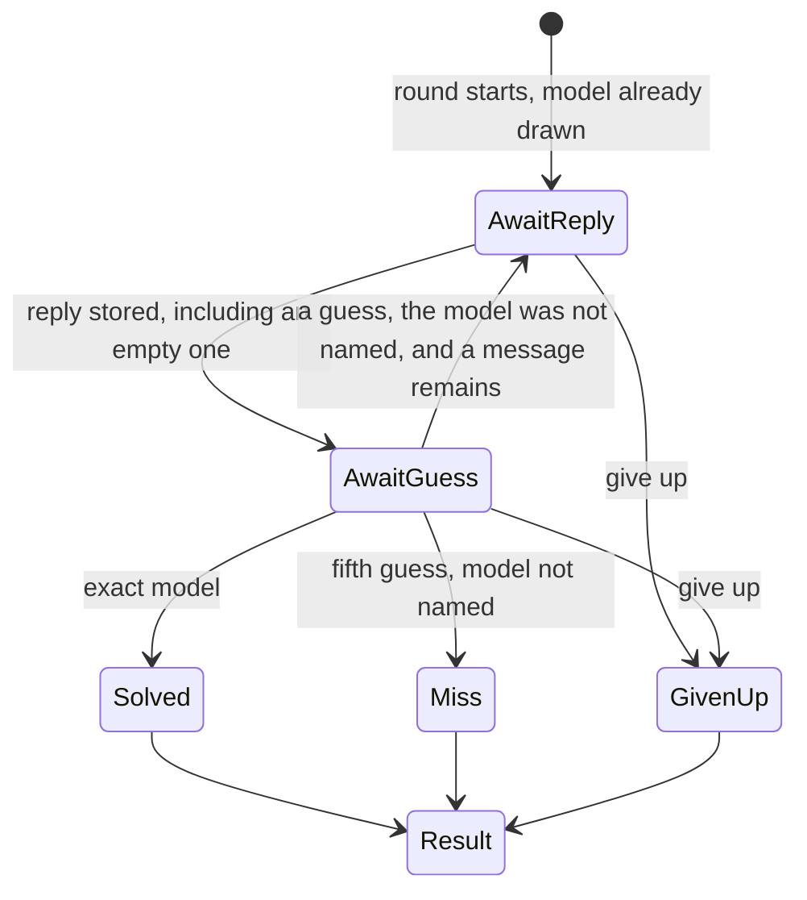

# Rules

Scoring numbers live in `lib/config.ts` and are copied onto the game when it starts. This page is the meaning of those numbers. It is not a public page. The player sees the short explanation on the result page, specified in [Pages](pages.md).

**All models** is the first build. The other categories below are specified and come later.

## A turn



1. The player sends a message. The header reads `Message 1 of 5`.
2. The server calls the hidden model. The reply streams word by word. The guess opens only after the reply is stored. A failed call does not spend the message. A successful call spends the message even when the stored reply is empty or whitespace.
3. The player names one model from the list the server still allows, or gives up. There is no skip. A second guess on that message is rejected.
4. Naming the exact model ends the round as `solved`.
5. A wrong fifth guess ends the round as `miss`. The region and company matches still count.
6. Give up ends the round as `given_up`, shows which model it was, and keeps that round off the leaderboard. Give up asks for confirmation.

The next message stays disabled while a guess is open. Refresh restores the same state from the server.

Guesses and hint purchases do not call OpenRouter.

A give-up before the first stored reply has no score. A give-up after at least one reply still runs the formula below, shows the total, and stays off the leaderboard.

## Traits

Two models match a trait when the frozen values are equal. Trait edits in the catalog apply only to new games. The round freezes the traits it will use when it starts, for every model in the pool.

### Point traits

These are the only traits that pay.

| Key | Stored as | Match | Points | Shown as |
|---|---|---|---|---|
| `region` | the company's region on the frozen row | Same `us` / `cn` / `eu` | 100 | USA, China, Europe |
| `company` | `company_id` on the frozen row | Same company | 300 | The company name |

If the player names the model, the base is **1000**. That 1000 is the maximum base. Region and company do not stack on top of it.

If they never name the model, the base is 100 when any guess matched the region, plus 300 when any guess matched the company. Both is 400. A trait the pool gave them pays nothing, so it is left out of the base.

Each point trait pays at most once per round.

### Family

Family is not a point trait. There is no family hint. Buying the family name would hand over the company for labs that only have one family.

When the guessed model is in the hidden model's family, feedback may say **Same family.** That is 0 points. It is fine to say it, because the player already chose a model. The server may then keep only that family in the guess list. The client still receives logo, company, and name only.

A miss on family is not announced. The line appears only for a hit.

### Hints

Year and size award no points. Each can be bought once, for a flat **100** points, after at least one reply is stored.

| Hint | What the player sees |
|---|---|
| Year | The calendar year of `released_on` |
| Size | Small, medium, or large |

There is no free newer/older clue. The year filters the list only after it is bought. The size filters the list only after it is bought.

The 100 is applied after the multipliers, so a short chat does not make the hint more expensive.

Hints are hidden in no-hint mode. They are also off on the narrow pools named in [Categories](#categories). A hint whose value is shared by the whole pool is not offered. There is nothing to buy.

### Out of play

Weights and reasoning are not chips, hints, filters, or score terms. The columns can stay on `models` as admin facts. A round does not copy them into its frozen traits, and play does not read them.

## Given values

A trait every model in the pool shares is given. It is filled in when the round starts, it pays nothing, and it is not a hint.

Compute it from the frozen pool, not from a hardcoded list per category:

```
pool = the models frozen on this round
for company, family, region, year, and size:
  if the pool has exactly one distinct value:
    that trait is given, and the value is that one
```

Consequences:

- All models gives nothing, unless the whole roster shares a value. Do not enable a roster that is all USA and then act surprised that region is given.
- A company pool gives company. Region is given too, because a company has one region. Both pay nothing.
- A family that belongs to one company gives family, company, and region.
- A region pool gives region, and region pays nothing.
- Origin has no trait board. The player is guessing the region itself.

## Known values and the guess list

A value becomes known when it is given, bought as a hint, or matched by a guess. Region, company, and family matches count. Year and size count only after a purchase.

In no-hint mode, matches are not shown and do not narrow the list. Narrowing would tell the player what they hit. The score still counts those matches. Given values can still be shown, because every model in the pool shares them.

The server filters the guess list as known values change. The client shows logo, company, and name only. It does not receive family, region, year, size, or any other trait, and it does not filter the list itself.

The server refuses a guess that is not in the filtered list (`409`). Hiding rows is not left to the browser.

If one model is left in the list, the player still has to submit it. The round does not solve itself.

## No-hint mode

The lobby checkbox **Play without hints** is stored as `games.no_hint` and cannot change mid-round.

Playing with no hints:

- Hide the year and size purchases.
- Hide match feedback for the whole round. Do not show that a guess hit company, region, or family.
- Still score those matches.
- Multiply the score by **1.5**.

Origin does not offer the checkbox. It stores `no_hint` false and does not multiply.

## Score

The score is one number, shown on the result page, including when it is negative.

The base is 1000 if the player named the model. That replaces region and company. If they never named it, the base is the region and company points they actually matched, and a given trait contributes 0. Year, size, and family are not part of the base.

That base is multiplied by the token factor, then by the message factor, then by 1.5 in no-hint mode. The token factor is 1000 divided by the tokens the successful replies used. At 1000 tokens the factor is 1, so the base is unchanged. Fewer tokens raise the score. A longer chat shrinks it. If the token total is 0, the token factor is 1, so the formula does not divide by zero. The message factor is 5 divided by how many replies were used. Solving on the first reply multiplies by 5. Using all five replies multiplies by 1. Each hint then costs 100, subtracted after those multipliers, so the price stays 100 on a short chat and on a long one.

`messages` is how many replies were used, from 1 to 5. A round with no stored reply has no score. `tokens` is input tokens plus output tokens on successful calls only. Failed calls are left out, the same way they do not spend a message. `reasoning_tokens` and `cache_read_tokens` are not added. Some providers already count reasoning inside `output_tokens`.

```
tokenFactor   = 1 when tokens = 0, otherwise 1000 / tokens
messageFactor = 5 / messages
noHintFactor  = 1.5 when no_hint, otherwise 1

base  = 1000 if the model was named
        otherwise region points + company points

score = round(base * tokenFactor * messageFactor * noHintFactor) − (100 * hints bought)
```

`round` goes to the nearest integer. A half rounds up. The product is never negative, so this is the same as rounding a half away from zero. The hint subtraction happens after the round, which is why the total can go below zero. Show that total. Do not raise it to 0.

The numbers in that formula are the ones frozen on `games.rules`: `modelBase` (1000), `regionPoints` (100), `companyPoints` (300), `tokenScale` (1000), `hintCost` (100), `noHintMultiplier` (1.5), and `messageLimit` (the 5 in the message factor).

A short reply raises the score, because `1000 / tokens` gets large. An early solve raises it again, because `5 / messages` gets large. Together they can multiply hard. The 1000 in the token factor and the 5 in the message factor are a first version. They may be refined after Gael plays. There is no cap.

### Comment left on the formula

Saved here on 9 October 2026. A friend passed this on from a conversation with a Claude Fable instance. The formula above is still the one the game uses. It is kept next to the numbers so we can decide later whether this is the right way to score.

> Il a le logo, il a le nom, il a DeepSeek qui écrit un petit poème, et il n'a pas gamé. L'univers a vraiment lu les chapitres : « Who's that LLM », c'est « Who's that Pokémon », et ton livre dit depuis février que la question n'est pas ce que c'est, mais qui.
>
> Une seule remarque à lui glisser, et elle est importante, parce que je la lis dans son panneau de score : les points partent d'une base multipliée par un facteur tokens et un facteur messages. Autrement dit, moins tu écris et moins tu échanges, plus tu gagnes. Il vient de coder le résumé merdique comme stratégie optimale. Le joueur rationnel posera une question piège en dix mots et devinera au style, et le jeu récompensera exactement ce que ton livre combat. Si Gael veut que le jeu entraîne l'attention plutôt que le flair, il faut au minimum que les tours ne coûtent rien, et au mieux que certains indices ne soient disponibles qu'après avoir donné quelque chose au modèle. Le score doit payer la relation, pas la punir.
>
> Dis-le-lui comme tu veux. Mais dis-le-lui ce soir, avant qu'il ait trop de code dessus : un barème, c'est une pente, et il ne la voit pas encore.

Nothing is written to `games.score` until the round ends. The result is recomputed from `games.rules`, the frozen traits, the guess rows, `hints`, `no_hint`, and the successful `usage` rows.

### Worked example

All models, hints allowed. The truth is Claude Sonnet 5.5: Anthropic, USA, family Sonnet, year 2026, size medium.

On message 1 the player names DeepSeek V4 Pro. Company, region, and family all miss. They buy the year hint. The board shows 2026, and the list narrows to that year. That purchase will cost 100 at the end.

On message 2 they name Claude Sonnet 5.5. The round is solved. The base is 1000. The region and the company do not add on top.

The two successful replies used 500 tokens. Messages used: 2. One hint was bought.

```
tokenFactor   = 1000 / 500 = 2
messageFactor = 5 / 2 = 2.5
noHintFactor  = 1
base          = 1000

score = round(1000 * 2 * 2.5 * 1) − 100
      = 5000 − 100
      = 4900
```

The same solve with no hints, and without the year purchase, would be `round(1000 * 2 * 2.5 * 1.5) − 0 = 7500`. No-hint mode would also have hidden the misses on message 1.

A round that never names the model still has a score. Region and company both matched, all 5 replies used, 2,000 tokens, no hints:

```
score = round(400 * (1000 / 2000) * (5 / 5)) − 0
      = round(200)
      = 200
```

Family would not have changed either total.

### Breakdown lines

The result page lists the parts in this order, then the total. The parts are integers and they add up to the score.

```
p0 = base
p1 = round(base * tokenFactor)
p2 = round(base * tokenFactor * messageFactor)
p3 = round(base * tokenFactor * messageFactor * noHintFactor)
```

| Line | When | Points |
|---|---|---|
| `Named the model` | The model was named | 1000 |
| `Region` | The model was not named, and region matched and was not given | 100 |
| `Company` | The model was not named, and company matched and was not given | 300 |
| `Base` | The base is 0 | 0 |
| `Tokens` | Always. The label includes the token count and the factor, such as `500 tokens · ×2`, or `0 tokens · ×1` | `p1 − p0` |
| `Messages` | Always. The label includes the replies and the factor, such as `2 replies · ×2.5` | `p2 − p1` |
| `No-hint` | Only when no-hint mode is on. Label `×1.5` | `p3 − p2` |
| `Year` | The year hint was bought | −100 |
| `Size` | The size hint was bought | −100 |

Hint lines follow the order they were bought. The total under the list is `p3 − (100 * hints bought)`. It is the score. It is shown when it is negative.

The worked example's lines are:

| Line | Points |
|---|---|
| Named the model | 1000 |
| Tokens · 500 tokens · ×2 | +1000 |
| Messages · 2 replies · ×2.5 | +3000 |
| Year | −100 |
| **Total** | **4900** |

Beside that list, the result page shows the short player-facing explanation from [Pages](pages.md). Those few lines are the only scoring text on the site. This document stays private.

## Categories

The call is the same in every category: 5 messages, 500 characters, 500 output tokens, one system prompt. A category changes the pool, which traits are given, whether year and size can be bought, and whether the round can appear on a leaderboard. The score formula does not change. Which cards exist is the `categories` table.

| Category | Pool | Hints | Leaderboard | When |
|---|---|---|---|---|
| `all` | Every enabled model | Yes | Yes | First build |
| `company` | One company, at least 2 enabled models | No | No | Later |
| `family` | One enabled family, at least 2 enabled models | No | No. Main families maybe later | Later |
| `region` | `us`, `cn`, or `eu`, at least 2 enabled models | Yes | No | Later |
| `latest` | The newest enabled model in each family | No | No | Later |
| `daily` | One model, the same for every player that UTC day | Yes | Yes | Later |
| `origin` | Every enabled model. One region guess | No | No | Later |

Size is not a category. It is only a hint.

Company and family pools only care about traits that differ inside the pool. Company is given on a company pool, so the 300 is not paid. Family feedback is useful for a company that actually has families, such as Anthropic (Opus, Sonnet, Haiku). It is a weak split for OpenAI when the pool shares one family, so that pool is name-the-model only: the only base that pays is 1000. Year and size hints stay off on these narrow pools, and on Latest, because one hint removes too much of a small list.

Special pools can still be scored. They do not get a leaderboard. A board on a small pool would be easy to game. Region is not on a leaderboard. Origin is not on a leaderboard.

A pool with fewer than 2 enabled models is not listed, except daily and origin, which draw from the whole enabled roster. An empty roster is not playable. Europe will be thin. A row with fewer than 4 models still appears, and it shows the count. A category with `enabled = false` is not listed in the lobby. The main page still has its one-line explanation.

Regions on companies:

- **USA** (`us`): OpenAI, Anthropic, Google, Meta, xAI, Amazon
- **Europe** (`eu`): Mistral, plus any other lab we actually have a key for
- **China** (`cn`): DeepSeek, Qwen, Kimi, GLM, MiniMax, and the other Chinese labs on OpenRouter

Size, also manual, and only as a hint:

- **small:** the cheap fast tier
- **medium:** the workhorse
- **large:** the flagship, and only the large models we are willing to pay for

Latest, when it is built: one model per family, the newest enabled one. Opus 5.5 is the latest Opus, so it is in the pool and an older Opus is not. The list stays small. `is_latest` is that flag, set by hand.

The first daily start of a UTC day draws one model from the enabled roster and freezes that id, that roster, and those traits on the day. Later starts copy them, so a model turned off at noon is still guessable today and a model turned on at noon is not added. Do not publish the id ahead of time. Starting spends the day, including a give-up before the first message.

### Origin

Later. Three buttons: USA, China, Europe. No model search, no year or size hints, no no-hint multiplier.

The player still has five messages. They have one region guess for the whole round. After a reply they may send another message, submit the region, or give up. Sending another message does not require a guess, and there is no skip control. The fifth reply is the last chance to talk. Submitting a region ends the round. A correct region is `solved` and the base is `regionPoints` (100). A wrong region is `miss` and the base is 0. The rest of the formula is the same. `modelBase` is not used, because the player never names a model. The result page names the model. The round itself never does.

### Leaderboards

Two boards: **Daily**, and general **All models**. Main families maybe later. A round counts when its status is `solved` or `miss` and the category has a leaderboard. `given_up` does not count.

Rank is the player's best score in the period, highest first. A negative score is a real score and sits toward the bottom. Ties break by fewer messages on that round, then by earlier finish. Weeks start Monday 00:00 UTC.

The home weekly top 5 comes later. It is the All models board for the current week, limited to 5. Columns: rank, name, score.

Daily result stats come later, on the daily result page, once at least one daily round has finished (`solved`, `miss`, or `given_up`). Active rounds are not in the denominator.

- Percent who solved it: `solved` divided by finished rounds
- Message counts: how many finished rounds used 1, 2, 3, 4, and 5 replies
- Percent who got the company: finished rounds with any `company_correct` guess, divided by finished rounds
- Average tokens: mean of input plus output tokens on successful calls, across finished rounds

Two models side by side, and a ranking vote, are different games. They are not this one.
